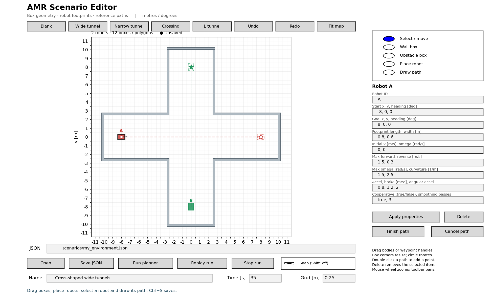
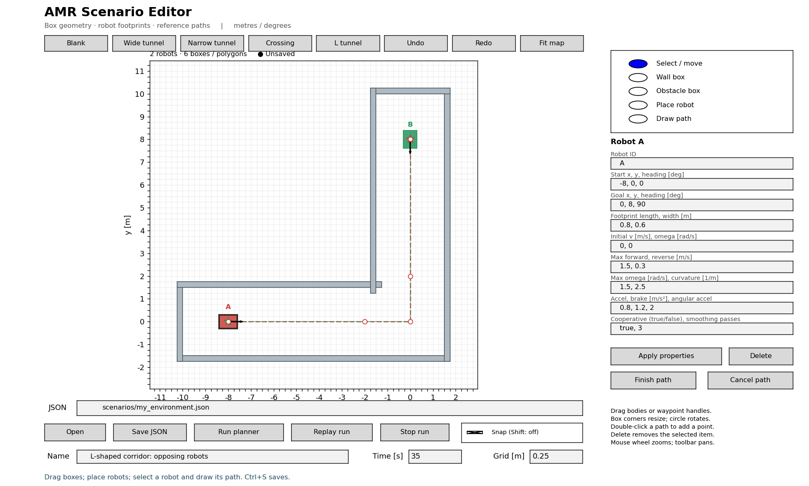

# Desktop map and mission editor

`visualization/editor.py` is a local Python/Matplotlib editor for the existing
scenario JSON format. Planning and simulation run in the C++ executable.
There is no browser service, Python planning implementation or new GUI framework.



## Start

From `tools/path_planner_sim`:

```bash
PYTHONNOUSERSITE=1 MPLCONFIGDIR=/tmp/path-planner-mpl \
  python3 visualization/editor.py
```

Use the same Python environment as replay. Ubuntu's `python3-matplotlib` and
`python3-tk` provide a desktop backend. A clean virtual environment can use
`visualization/requirements.txt` and an installed Tk or Qt backend. A graphical
X/Wayland session is required for interactive windows. Matplotlib distinguishes
[interactive and file-only backends](https://matplotlib.org/stable/users/explain/figure/backends.html).

```bash
python3 visualization/editor.py --scenario scenarios/head_on_wide.json \
  --output scenarios/my_tunnel.json
python3 visualization/editor.py --preset blank
python3 visualization/editor.py --preset narrow
python3 visualization/editor.py --preset crossing
python3 visualization/editor.py --preset l_shaped
```

Options also include `--binary`, `--runs` and `--seed` (default 42). For automated
preview without a desktop:

```bash
PYTHONNOUSERSITE=1 MPLCONFIGDIR=/tmp/path-planner-mpl \
  python3 visualization/editor.py --preset crossing --snapshot runs/editor.png
```

## Building environments

1. Choose **Blank** or a template. Wide and narrow templates use the existing
   passing scenarios. Crossing builds a cross-shaped pair of 5 m wide corridors
   with twelve physical wall boxes and two intersecting robot missions.
   **L tunnel** builds a 3 m-wide corridor with six wall boxes and two opposing
   missions: A follows `(-8, 0)` to `(0, 8)` via `(0, 0)`; B starts at the other end
   facing down and follows the same points in reverse. Collinear points before
   and after the elbow control how much the core rounds the corner.
2. Select **Wall box** or **Obstacle box**, then drag opposite corners on the map.
   These labels only affect the editor's coloring; both export collision geometry
   in the same `obstacles` array. Dimensions must be positive.
3. Use **Select / move** to drag a box. Its four square corners resize while the
   opposite corner remains fixed. The circular handle rotates around its center.
   Enter exact center coordinates, angle and dimensions in the inspector, then
   click **Apply properties**.
4. Choose **Place robot** and click its start. A distinct robot ID and a short
   initial path are created. Select **Draw path**, then click intermediate points
   and the desired goal. Enter/right-click commits the complete path. Escape
   discards the draft and preserves the prior path; Backspace removes its last
   draft point.
5. Repeat for additional robots. Each has independent footprint, initial speed,
   motion limits and cooperative setting. Color identifies each robot and route.
   Solid bodies are starts; stars and dotted footprints mark goals.

While selected, robot path vertices become draggable handles. The first point
sets the start and the last sets the goal; moving either updates both the path
and corresponding pose. Dragging vertices aligns endpoint headings to the first
and final path segments. Enter a manual heading in **Apply properties** afterward
when required. Headings in the inspector are degrees; JSON uses radians. Initial
yaw rate, steering limits and angular acceleration use radians in SI units as
their labels indicate.

To draw your own L-shaped route, place the robot, choose **Draw path**, click the
elbow, then the goal, and press Enter. Add straight approach/exit points near the
elbow to control smoothing in a tighter tunnel. The native scenario
`scenarios/l_shaped_corridor.json` can also be run directly by the C++ CLI.
The editor's two-robot preset is `scenarios/l_shaped_head_on.json`. Wall occlusion
keeps both robots nominal until the other becomes visible. Same-side replanning
and a footprint-cleared return let both finish in 16.5 s with zero collisions and
clearance violations in this configuration. Use
`--scenario scenarios/l_shaped_corridor.json` to load the completed single-robot
version. When a goal overlaps another robot's start, clicking the solid body
selects that starting robot; use the inspector's Goal field to move an overlapping
goal independently.

In replay, `observed=none` means no robot track is supplied. `*` denotes a recently
lost measurement. Dash-dot geometry shows the intended merge back to the route;
the thicker solid line is the finite timed trajectory. After changing planner or
sensor code/settings, click **Run planner** again to generate a new recording.



Double-click a path segment in Select mode to insert a waypoint. Select an
intermediate point and press Delete to remove it. Endpoints must be moved rather
than deleted. Click the robot body to select and delete the whole robot. Deleting
a robot also removes events targeting its ID; Undo restores both.

## Navigation and history

| Action | Control |
| --- | --- |
| Select / wall / obstacle / robot / path | Tools or keys 1–5 |
| Save scenario | Save JSON or Ctrl+S |
| Undo / redo | Buttons or Ctrl+Z / Ctrl+Y (Ctrl+Shift+Z also supported) |
| Delete selection | Delete key or button |
| Finish path | Enter, right-click, or Finish path |
| Cancel drawing | Escape or Cancel path |
| Fit all geometry | Fit map or F |
| Zoom at pointer | Mouse wheel |
| Pan / box zoom | Matplotlib toolbar |

Grid snapping defaults to 0.25 m. Edit **Grid [m]**, toggle Snap, or hold Shift
temporarily to bypass snapping. Box rotation snaps to 15° while Snap is enabled.
Toolbar navigation temporarily disables map editing to prevent accidental edits.
A completed drag is one undo operation. Template changes, loads, property edits,
placement and path replacement are undoable; history retains 100 operations.

## Save, run and inspect

The **JSON** field names the file used by **Open** and **Save JSON**. Change it to
save under another name or open a different file. An initial `--scenario` defaults
to a separate `<name>_edited.json` save path. Save replaces the explicitly named
file using same-directory atomic replacement. Loaded planner parameters, timed
events and unknown robot/scenario metadata survive round trips. Events can be
authored in JSON; the GUI does not yet provide an event timeline.

Empty map drafts may be saved and reopened. A runnable scenario needs at least
one robot and a nondegenerate reference path. Finish/cancel active drawing before
Save or Run. **Name** and **Time [s]** are applied when saving/running. Save before
closing to retain edits; automatic session recovery is not implemented.

Build the simulator before using **Run planner**. Each run creates a fresh
`runs/editor_<unique id>/` directory containing `scenario.json` (the exact editor
snapshot), `simulation.log`, and normal configuration, metrics and playback files.
The C++ process runs asynchronously so the document remains editable. **Stop run**
terminates this owned child process; a cancelled run may have no recording.
Closing the editor stops an active simulation.

The footer reports completed/unresolved/collision outcome, goal count, collision
and clearance counts, and simulated duration. **Replay run** opens the most recent
finished recording in an independent replay window. That recording is tied to
its saved snapshot, even if the editor document has since changed. Native C++
configuration errors appear in the footer/terminal and the run's log.

Authoring validation checks finite coordinates, box/footprint sizes, unique IDs,
path endpoints and motion-limit fields. C++ remains authoritative for scenario
and planner parameter validation. This is not a geometric feasibility indicator:
an authored reference path may intentionally cross an obstacle to test bypassing.
Use recorded collision/clearance/goal results to evaluate the environment.

## Scope and verification

Boxes support translation, resizing and rotation. Imported convex polygons can
be displayed, moved and deleted; vertex editing is not implemented. There is no
freehand wall polygon tool, automatic global routing, multi-selection, event
timeline UI, autosave, or advanced planner-parameter form. Raw waypoint paths are
shown in the editor; the core applies the configured smoothing at execution.

Automated editor tests exercise JSON round trips and event references, atomic
edits, undo/redo, box creation/movement/rotation/resizing through mouse callbacks,
robot/path edits, waypoint insertion/deletion, property validation and saving.
A map constructed from an empty document is exported and run through the real
C++ executable: both opposing robots complete passing with zero collisions and
clearance violations. Snapshot isolation, native validation failures and process
cancellation are also tested. GUI callbacks are exercised with Matplotlib's Agg
backend; physical desktop interaction has not been tested in this environment.

```bash
PYTHONNOUSERSITE=1 MPLCONFIGDIR=/tmp/path-planner-mpl \
  python3 tests/integration/editor_tests.py -v
ctest --test-dir build --output-on-failure
```

CMake registers editor tests when Python 3.10+ is available. GUI callback tests
are skipped if Matplotlib is absent; document and native runner tests still run.
