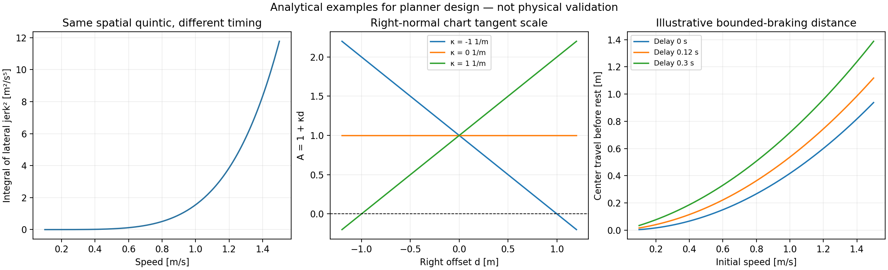

# Research review: cooperative planning for differential-drive AMRs

Review date: 2026-10-30. Scope: all five supplied PDFs, the supplied GPT analysis,
selected additional primary literature, and the current `planning_core` code.

**Recommendation:** develop a low-speed Werling-inspired trajectory planner as a
second baseline, with explicit space-time scheduling for bottlenecks, prediction
with uncertainty, and an independent executable-trajectory acceptance check.
Evaluate a TEB-style refiner and ORCA-based baselines separately. Do not put all
five methods into one optimizer or assume their guarantees compose.

The current simulator is a useful experimental foundation. Its successful
L-shaped encounter is evidence for that particular configuration, not yet
evidence of reliable operation with limited perception, delays and loaded robots.

## Read the review

| Document | Contents |
| --- | --- |
| [Paper-by-paper analysis](01_papers.md) | Algorithms, equations, assumptions, experimental evidence, failure cases, and adoption decisions for all five PDFs; deeper treatment of Werling |
| [Proposed AMR design and validation plan](02_design.md) | Current-code gaps, right-normal Frenet derivation, prediction, scheduling, fallback, interfaces, staged work and quantitative experiments |
| [Assessment of the supplied GPT analysis](03_gpt_analysis_review.md) | Supported recommendations, corrections, bibliographic verification, and what is already implemented |
| [Additional research and implementation sources](04_sources.md) | SIPP/SIPP-IP, continuous-time coordination, prediction research, original repositories and Nav2 boundaries |
| [Reproducible analytical results](analytical_results.json) | Small calculations used to check design claims; not comparative robot benchmarks |
| [Local PDF manifest](reference_manifest.json) | File identities and SHA-256 values for the five reviewed inputs |

## What to take from each supplied paper

These are engineering recommendations, not rankings established by a common
benchmark. Exact local-paper citations and page locators appear in the analysis.

| Paper | Take into our system | Do not inherit without revalidation |
| --- | --- | --- |
| Werling et al., 2010 | Low-speed `d(s)` candidates; explicit longitudinal modes; endpoint derivative matching; previous-plan continuation | Global optimality, recursive safety, or smoothness from a quintic alone |
| Rösmann et al., 2012 | Joint pose/time representation, differential-drive and wheel constraints, sparse local factors | Finite soft penalties as hard feasibility; the dense total-time-squared term as an ideal objective |
| Rösmann et al., 2017 | Warm-started SE(2) refinement, adaptive resolution, reverse-motion seeds, external verification | Car steering-radius restrictions as differential-drive physics; global convergence or guaranteed feasibility |
| Chung et al., ICRA 2022 / arXiv 2023 | Timestamped arbitrary intended trajectories, conflict priorities, narrow-aisle topology sampling | Broadcast as agreement, TCP as an execution guarantee, approximate H-signatures as exact topology certificates |
| van den Berg et al., supplied ORCA manuscript | Reciprocal responsibility, efficient neighbor handling, an independent low-cost baseline | Holonomic collision-avoidance proof after differential-drive conversion, braking limits, rotation or uncertainty |

## The decisions that matter most

1. **Geometry and speed need a shared feasibility calculation.** A smooth offset
   at 0.5 m/s and the same offset at 1.5 m/s are very different motion demands.
2. **Perception and communication are separate information channels.** Never
   fabricate a hidden agent's state, but do use a valid communicated reservation
   when the experiment explicitly enables that channel.
3. **A sampled horizon needs a valid continuation.** Preserve a checked stop/hold
   alternative; a collision-free path ending at speed is not enough.
4. **Bottleneck entry is a scheduling decision.** Neither more lateral samples nor
   a stronger smoothness penalty creates space in an impossible corridor.
5. **The controller must honor timing or trigger rescheduling.** A geometric
   `nav_msgs/Path` plus an ordinary speed limit cannot enforce a reserved slot.

## Immediate work proposed

Before adding a large optimizer, fix curved-reference derivative consistency,
prediction/intent validity, track-loss handling, and the stopping-continuation
acceptance test. Then implement a bounded candidate lattice with timed longitudinal
modes as a separate planner. Add a small critical-region scheduler with physically
feasible entry/exit primitives. Only add numerical refinement if paired experiments
show that candidate-only planning leaves useful solutions undiscovered.

The implementation plan and interfaces are proposals. This research task changes
documentation and adds analytical checks; it does not replace the running planner,
install ROS packages, or claim a validated new navigation algorithm.



Reproduce the examples from the project root:

```bash
python3 scripts/research_checks.py --output /tmp/research_results.json
PYTHONNOUSERSITE=1 MPLCONFIGDIR=/tmp/path-planner-mpl \
  python3 scripts/research_checks.py --plot /tmp/research_examples.png
```

## Evidence boundaries

The five local papers were extracted in full, and nine pages containing important
equations, algorithms and result tables were rendered for visual inspection.
Page references in this review use **1-based PDF page numbers**, not printed
conference page numbers. The Werling PDF has a cover page; the IROS 2017 PDF has
a copyright cover. Their actual articles are seven and six pages respectively.

Additional literature was checked through the authors, publishers, proceedings,
or official implementations; the depth of verification is stated per source.
The supplied GPT write-up is a set of claims to evaluate, not independent
experimental evidence. Author-reported results, code observations, our derived
examples, and proposed changes are labeled separately. No external planner was
built or benchmarked during this review.
