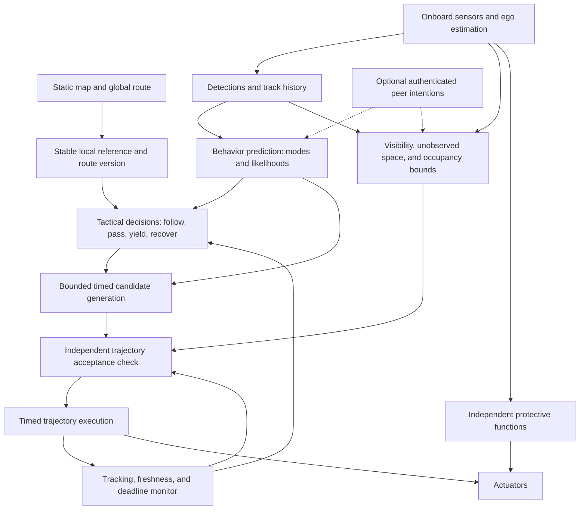

# Proposed perception-driven planner and execution architecture

Review date: 2026-11-01. This is a design proposal, not an implementation or a deployment safety claim. Reference IDs correspond to [the paper review](01_paper_review.md). The operating requirement follows the **last** revision in the supplied GPT conversation: navigate among unknown robots from onboard observations; fleet communication is optional.

## 1. The engineering decision

Build a predictive local trajectory planner with three independently inspectable boundaries:

1. **What probably happens:** tracking and behavior predictions used to choose efficient maneuvers.
2. **What motion we can accept:** executable-trajectory validation against an explicitly stated uncertainty and other-agent model.
3. **What the robot actually does:** a timed execution contract, tracking monitor, deadline handling, and an independently available protective stop.

Keep the current deformation planner as a regression baseline. After establishing the observation, prediction, acceptance, and execution contracts, compare a tuned Nav2 MPPI baseline, an MPPI extension with time-indexed other-agent occupancy, and a bounded Frenet/SE(2) prototype with a timed follower. Do not commit to a full separate trajectory planner before this comparison. A small candidate prototype is needed to measure its value; its superiority is a hypothesis. Introduce numerical refinement only if measured failures show that candidate coverage is the limiting factor. An optimizer cannot recover missing observations, create passing space, or establish consent from another vendor's robot.



“Independent” here means separate acceptance logic and observable failure states. Reusing the same geometry library is sensible, but it does not make two copies of the same defect independent evidence. Use an additional offline collision oracle when validating the simulator.

## 2. Define the operating envelope before optimizing speed

Keep the current simulator's 0.8 x 0.6 m footprint, 1.5 m/s forward speed, and configured 1.2 m/s² deceleration fixed for this research baseline, as requested. Make them tunable later. These values are not measurements of the eventual loaded robot. Production parameters need measured distributions or conservative bounds for:

- Loaded/unloaded braking, traction, slope, wear, battery state, and turn-dependent deceleration.
- Command, actuator, sensing, estimation, transport, and computation latency.
- Localization error, tracking error, shape uncertainty, detection range, and occlusion geometry.
- Plausible other-agent speed, acceleration, turn rate, dimensions, and intrusion behavior.
- Permitted stop locations, retreat locations, passing widths, and inaccessible recovery zones.

There are three distinct promises. A plan can be collision-free against a forecast, robust against a bounded set of other-agent motions, or passively safe in the sense that the ego robot is stopped before a possible contact. These promises are not interchangeable. OA-MPC's stopping formulation is an especially useful example of why reading the constraint matters, not just the title [R58].

Against an arbitrary robot that deliberately continues into us, an indefinitely collision-free stopped state may not exist. State that limit in the operating envelope. Fast motion remains a conditional objective: use the highest speed for which the current visibility, uncertainty, control authority, and continuation permit acceptance.

For a straight-line illustrative stop, with initial speed `v`, worst-case response delay `L`, and guaranteed deceleration magnitude `b`,

\[
t_{stop}=L+v/b,\qquad d_{ego}=vL+v^2/(2b).
\]

This is center travel under a simplified model, not a complete protective field. An opposing robot that maintains speed `u` consumes another `u*t_stop` of gap before we stop. Robot extents, uncertainty, and clearance are additional. Assuming both robots brake is a materially different experiment. Even sufficient gap until our stop says nothing about a later collision with the continuing opponent.

At an occluded corner, apply the same reasoning to the **swept footprint and possible emerging occupancy**, not merely the distance from the robot's center to the wall. Slower motion and a wider sightline can be required. A known speed bound for hidden traffic is an assumption, not a sensor output.

## 3. Perception and tracking

The simulator currently filters ideal state measurements by range, field of view, and walls. That establishes an observation boundary, but it is not LiDAR detection, data association, or state estimation. A production-facing experiment should consume the same track interface as the robot:

```text
Track:
  local_track_id, measurement_time, last_visible_time
  pose/position estimate, velocity estimate, covariance or bounded set
  footprint estimate and uncertainty, class/confidence
  visibility and existence confidence, observation history
```

The identifier is a local association key. It is not a globally agreed fleet priority. Do not expose the engine's robot identity, exact dimensions, cooperative flag, goal, or controller policy to the perception-only planner unless the simulated sensor/estimator actually supplies that information.

Start with an inspectable estimator: ego-motion compensation, detection grouping or a detector, gated association, position/velocity filtering, and explicit track birth/loss. Compare nearest-neighbor association with a stronger method only when recorded crossing/occlusion failures warrant it. Two 2D LiDARs need time alignment and extrinsic calibration. A nearly stationary or symmetric observed object can have poorly observable yaw; carry uncertainty instead of inventing a precise heading.

Track loss should propagate occupancy, not instantly erase an obstacle. The amount of retained occupancy should depend on last measurement, feasible motion, map accessibility, and new negative observations. A permanently growing worst-case disc can freeze the robot; deleting it after a fixed timeout can be unsafe. Visibility evidence should remove regions that have actually been observed empty. A missing detection and a reliable empty-space observation are different inputs.

Static maps may be known. Unexpected static objects must still come through sensing or an explicit map update. The evaluation engine can retain complete world truth for scoring.

## 4. Prediction: establish simple, calibrated models first

Use a bounded collection of physically coherent hypotheses:

- Constant world velocity for short, approximately straight motion.
- Constant turn rate and speed for a turning ground robot when yaw/turn-rate estimates support it.
- Bounded acceleration and stopping branches.
- Map-compatible continuation through straight and turning branches.
- A nonreactive branch for an unknown robot, even when an interaction model predicts yielding.

For body-forward speed `v` and yaw rate `w`, CTRV has

\[
x(t)=x_0+\frac{v}{w}[\sin(\theta_0+wt)-\sin\theta_0],
\]
\[
y(t)=y_0-\frac{v}{w}[\cos(\theta_0+wt)-\cos\theta_0],
\]

with a numerically stable straight-line limit as `w` approaches zero. Rotating an oriented rectangle while translating its center at fixed world velocity is a different model. The current fallback does the latter; it should not be called CTRV.

Keep prediction outputs separate from their use:

```text
PredictionBundle:
  epoch, expiry, source, model_version
  behavior hypotheses with weights and timed poses
  uncertainty/occupancy representation over time
  assumptions and validity flags
```

Use performance forecasts to compare progress and delay. Use the accepted uncertainty envelope to reject incompatible motion. If only probabilistic occupancy is tractable, record the probability model, calibration procedure, risk allocation, and consequences of out-of-distribution behavior. A covariance matrix is not itself evidence that a confidence region has the advertised coverage.

Interaction-conditioned forecasts from Trepella, SICNav, and Trajectron++ are useful research alternatives [R10, R48, R53]. They should first compete against simple models on recorded local traffic. A forecast in which a person moves away from our planned motion does not make that reaction enforceable. Refitting predictions until they avoid the ego plan can create an optimistic feedback loop unless a nonreactive alternative remains represented.

Evaluate prediction with time-indexed occupancy coverage, calibration, missed modes, and closed-loop navigation outcomes. Best-of-K displacement error gives the evaluator access to the best sample after observing the future. The controller does not have that oracle. Marginally accurate forecasts for each agent may also form an impossible joint scene.

## 5. Generate geometry and timing together

For an ordinary route segment, use a local, regular reference curve and bounded lateral and longitudinal families. Match the current boundary state, retain a revalidated previous-plan continuation, and offer follow, stop, arrival-window, and velocity-keeping modes. A choice among a few constant speed multipliers does not cover those timing decisions.

### Right-normal Frenet conversion

The code uses the robot's **right** normal. Let `t` be the reference tangent, `n_R` its right normal, and `kappa` the usual signed, left-positive reference curvature. Then

\[
p(s)=r(s)+d(s)n_R(s),\quad A=1+\kappa d,
\]
\[
p_s=A\,t+d'\,n_R,\qquad
\Delta\theta=\operatorname{atan2}(-d',A).
\]

Consequently, a measured heading difference implies

\[
d'=-A\tan(\Delta\theta),\qquad
v=\dot{s}\sqrt{A^2+(d')^2}.
\]

Using `-tan(delta_heading)` alone is only the straight-reference approximation. A body speed is not generally the same as reference arc-length speed. With a sufficiently smooth reference,

\[
\kappa_p=\frac{\kappa A^2+2\kappa(d')^2+\kappa' d d'-A d''}
{[A^2+(d')^2]^{3/2}}.
\]

These are our sign-converted geometric derivations, not formulas copied with Werling's opposite-normal convention. The [finite-difference checks](05_analytical_checks.md) validate the formulas numerically; implementation still needs projection and boundary-state verification. Require a regular chart, bounded projection ambiguity, and `A > epsilon` for this forward candidate family. The current Chaikin-smoothed piecewise-linear reference does not directly supply a smooth `kappa'`. Either construct an appropriate reference with bounded derivatives or accept a rollout-based representation that does not pretend those derivatives exist.

Use SE(2) primitives for in-place rotations, reversals, tight corners, ambiguous projections, and terminal recovery. Switching representations needs a shared initial state and a checked transition. Reverse motion is an explicit behavior with rear sensing and a stop-and-direction-change policy, not a sign change added to a forward candidate.

### Smoothness must be checked in physical time

A quintic has useful boundary conditions. It does not make the complete Cartesian trajectory dynamically feasible. For the same straight-reference spatial offset `d(s)=D*q(s/S)`, executed at constant reference speed, temporal lateral jerk cost scales with the **fifth power of speed**. Geometry that is comfortable at 0.5 m/s may be unacceptable at 1.5 m/s.

For wheel separation `b_w`, wheel velocities and accelerations satisfy

\[
v_R=v+b_w\omega/2,\quad v_L=v-b_w\omega/2,
\]
\[
a_R=a+b_w\alpha/2,\quad a_L=a-b_w\alpha/2.
\]

Independent bounds on `v`, `omega`, `a`, and `alpha` do not automatically enforce wheel limits. Add the actual drive geometry and calibrated limits to the model. Verify loaded turning/braking behavior rather than treating a passenger-car minimum steering radius as differential-drive physics.

## 6. Accept a trajectory and its continuation

An accepted plan should include a prefix that can be executed before the next reliable update and a checked fallback from every relevant switching point. A practical first implementation can attach a bounded braking/holding continuation to selected prefix samples and reject a candidate if those continuations conflict with the accepted occupancy model. This is more expensive than checking a single brake from the current state, so cache and bound the work.

Acceptance should cover:

1. Finite, time-ordered states consistent with the selected motion model and measured initial state.
2. Body and wheel limits, direction transitions, actuator slew, and a sufficient braking horizon.
3. Continuous or conservatively covered footprint occupancy, including rotation and interpolation.
4. Static clearance, ego tracking/localization error, other-agent uncertainty, and latency.
5. Validity through the executable prefix and a fallback with explicitly described terminal occupancy.
6. A deadline and an expiry time. Finishing optimization after expiry does not renew a plan.

Keep these outcomes distinct: `Accepted`, `ContinuePrevious`, `Yielding`, `NoAcceptedCandidate`, `OutsideEnvelope`, and `ProtectiveStopRequested`. No safe maneuver being found is a real result. Never relabel an unchecked brake as a certified fallback. If no collision-free fallback exists, report the boundary violation and execute the best defined protective response; do not hide it by freezing simulated bodies.

Gaussian exclusion regions require particular care. Adding the robot radius to both ellipse semiaxes is not generally an outer approximation of the ellipse's Minkowski sum with a disc. Use a verified conservative construction, support functions, polygonal outer bounds, or direct probabilistic geometry. Also distinguish a fixed risk constraint from a desired confidence radius that the optimizer may reduce through a penalty. Pointwise confidence is not an episode-level safety probability.

## 7. Execution owns time

An execution contract should carry the plan epoch, route version, valid-until time, initial-state tolerance, tracking corridor, timing tolerance, permitted speed changes, and fallback identifier. Monitor actual state against it. A controller that substantially retimes or deforms the plan invalidates time-indexed obstacle separation unless the plan is rechecked.

Two viable experiments are a dedicated timed trajectory tracker and a Nav2 MPPI extension with time-indexed dynamic occupancy. The latter needs an acceptance/monitor boundary in addition to weighted critics. A standard geometric path does not encode a hard arrival window [R69]. Do not allow two modules to independently select competing avoidance maneuvers without a defined ownership boundary.

Plan generation can run slower than low-level control, but latency must be modeled. Shift or regenerate candidates to their intended execution epoch and validate the intervening motion. On missed deadlines, continue a still-valid previous plan or its validated fallback. Memory allocation, logging, parsing, and visualization should not create unbounded work in the control path.

## 8. Tactical recovery without assuming agreement

Use encounter memory to avoid gratuitous side changes, but permit a checked side change when the current maneuver is blocked and another is feasible. Add following and arrival-after-crossing alternatives before large lateral deviations. Distinguish a temporary yield from a persistent obstruction using observed progress and blocked-route evidence.

A unilateral safe-interval calculation means “our model currently predicts this time window is usable.” It is not a reservation honored by unknown traffic. A one-robot-wide blind passage may require waiting, retreat to a sensed bay, a different global route, environmental traffic controls, or an intervention. No local policy can promise deadlock freedom for an uncooperative robot that permanently blocks the only route.

Optional fleet coordination can later add explicit commitments, passage ownership, deadlines, and monitored release. Expired communication should not imply physical vacancy. DTEB and RMADER are relevant to that later layer, under their communication and behavior assumptions [R20, R21]. Preserve the ability to fall back to the perception-only operating envelope.

## 9. Immediate mapping to this repository

| Current location | Observation | Proposed change |
| --- | --- | --- |
| `planning_core/src/prediction.cpp` | Fixed world translation plus yaw rotation; a single fallback; intentions lack a measured-state agreement check | Coherent models, model provenance, uncertainty, intent consistency, and multiple hypotheses |
| `simulator/src/observations.cpp`, `engine.cpp` | Ideal measurements and simulator-known identities/footprints; hidden objects omitted; limited stale memory | Separate sensor/track interface, perception faults, visibility occupancy, and independent actor policies |
| `planning_core/src/path_deformation.cpp` | Forward-only rollout, speed scales, unicycle hard-coded in candidate generation | Explicit longitudinal modes and SE(2) recovery; shared model semantics with execution |
| `planning_core/src/cooperative_planner.cpp` | Right-side memory and globally stable-ID crossing preference; braking may also be infeasible | Observation-based tactical decisions, retained accepted continuation, checked fallback, explicit envelope failure |
| `planning_core/src/reference_path.cpp` | Approximate smoothing and projection; no smooth curvature derivative contract | Versioned regular reference or a representation that avoids unsupported Frenet derivatives |
| `planning_core/src/collision_checker.cpp` | Sampled trajectory checks with interpolation allowance | Verified swept occupancy bounds and fallback checking; independent offline oracle |
| `simulator/src/engine.cpp` | Execution model injectable, candidate rollout still uses `UnicycleModel`; same planner instantiated for every robot | Planner/actor factories, model consistency checks, sensor latency, compute deadlines, and heterogeneous behaviors |
| `simulator/src/controller.cpp` | Simple timed follower, fixed gains | Measured tracking/timing bounds, expiry handling, braking transitions, and adapter contract |
| `tests/`, `scripts/` | Useful deterministic cases; limited noise, behavior diversity, and timing faults | Paired parameter sweeps, statistically reported robustness, outcome definitions that include safety and intervention |

The code observations above describe the reviewed checkout, not verified production defects in another navigation package. Research and documentation changes should preserve the existing baseline until each proposed change has its own regression evidence.
