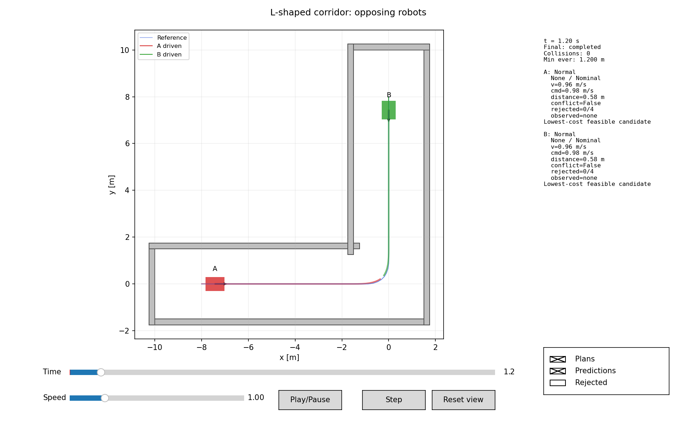
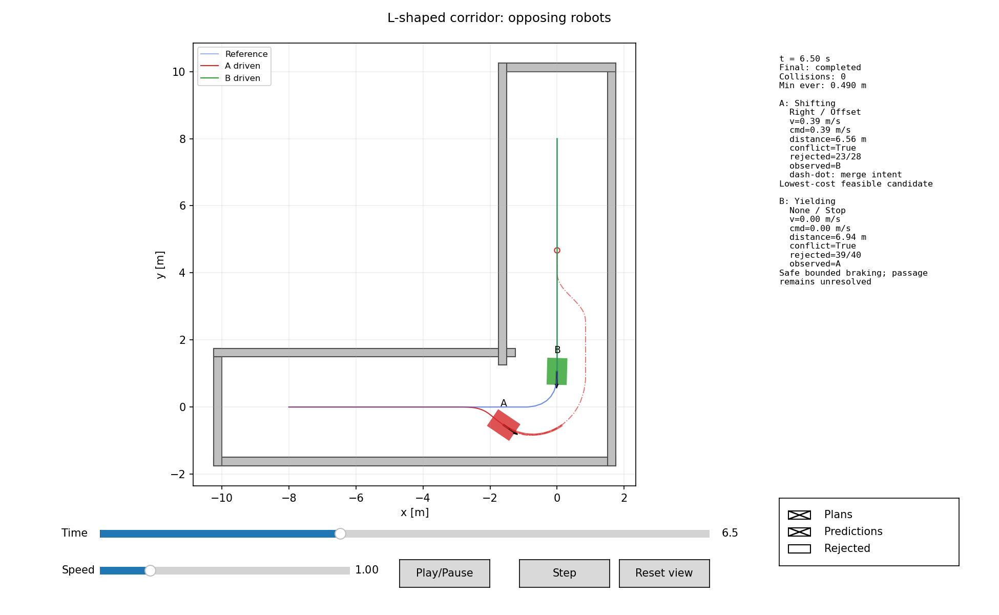
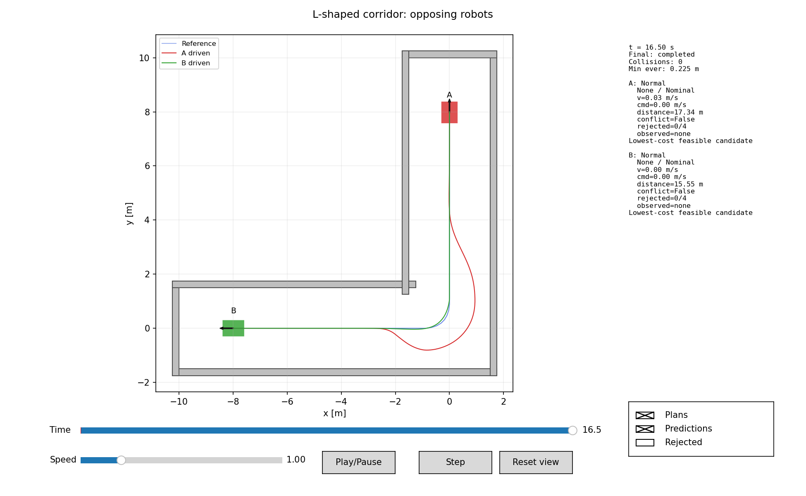
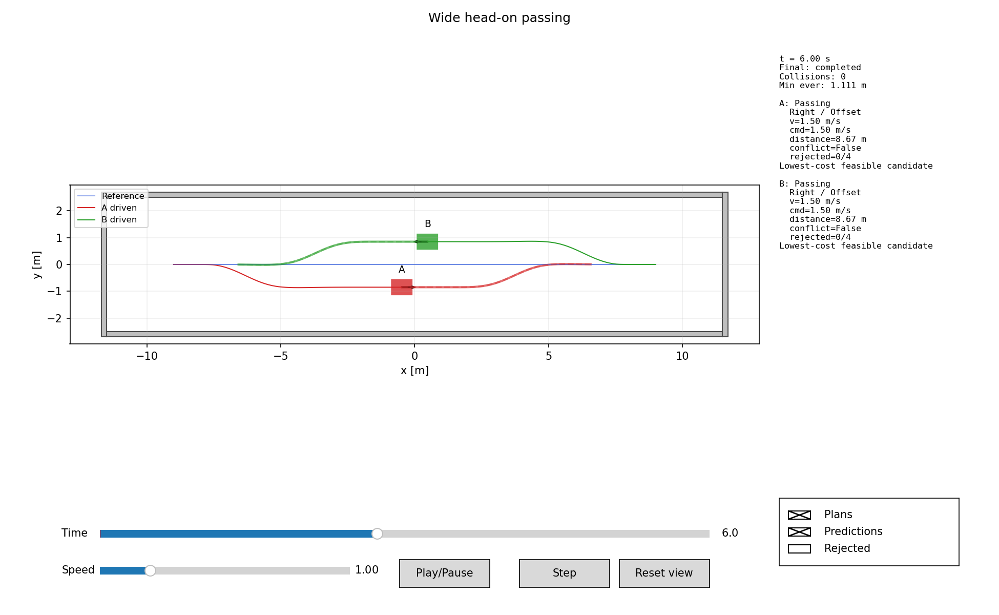

# V0.1 validation — 2026-10-30

Built and executed in the provided Ubuntu workspace with GCC 13.3.0, C++17,
CMake, nlohmann-json 3.11.3 and Boost 1.83. Release build; no ROS or MuJoCo required.
All work is isolated in `tools/path_planner_sim`.

## Automated verification

`ctest --test-dir build --output-on-failure` passes three CTest entries:
ten core Boost.Test cases, eight C++ integration suites, and thirteen Python editor
tests. The C++ suites cover sensor occlusion/range/FOV and empty
tracking, completed bilateral head-on passing, narrow unresolved stopping, static
obstacles on both sides, crossing, a completed L-shaped turn, and completed
opposing L-shaped passing after observation, replanning and rejoining. The head-on suite also repeats the run,
compares complete trace and diagnostic event values, and changes robot iteration
order. It verifies actual position exchange, opposite world-space right shifts,
centerline return, physical clearance, completed goals and actuator limits.
Loading the saved wide-corridor run configuration as a new scenario, with the
documented default-parameter override, also produced byte-identical trace and
event files.

Unit coverage includes segment distances, angle normalization, arc projection,
oriented footprints, boundary contact, convex-polygon validation, trajectory
interpolation, quintic endpoint derivatives, own-right sign, bounded reversal,
dynamic consistency, nominal progress, footprint-based early-return rejection,
between-sample obstruction, impossible passing geometry, commitment under small
observation changes, stale-intention fallback, current-offset Hermite replanning,
and buffer recovery that never relaxes required clearance.

The standalone core-only build/install and independent `examples/core_client`
build/run succeed. The client reports `Nominal: 126 timed points` and uses only the
installed planning target. Playback recordings load successfully, Python files
compile, and Matplotlib renders the passing snapshot below. Playback callbacks
(play/pause, stepping, seeking, speed, overlays, zoom preservation and reset) were
also exercised with the headless backend; a physical desktop was not used.
The desktop authoring extension is covered by mouse/keyboard callbacks, JSON
round trips, undo/redo, property rollback, a real C++ run of an editor-authored
two-robot map, immutable run snapshots, validation errors and cancellation. See
the [editor guide](editor.md) for controls and a rendered preview.

## Recorded scenario results

Commands use seed 42 and default planner parameters. Full results are retained in
`runs/reactive_validation/<scenario>/` (ignored generated artifacts); `aggregate.json` is the batch
summary. Run with fresh directories using the commands in the README.

| Scenario | Goals | Collisions | Clearance violations | Simulated duration | Outcome |
| --- | ---: | ---: | ---: | ---: | --- |
| Empty corridor | 1/1 | 0 | 0 | 13.50 s | Completed |
| Wide head-on, both initially 1.5 m/s | 2/2 | 0 | 0 | 13.20 s | Completed passing and return |
| Narrow head-on | 0/2 | 0 | 0 | 20.00 s | Safe unresolved stop |
| Static obstacle left of center | 1/1 | 0 | 0 | 14.98 s | Completed bypass and return |
| Static obstacle right of center | 1/1 | 0 | 0 | 14.98 s | Completed bypass and return |
| Crossing | 2/2 | 0 | 0 | 14.96 s | Completed |
| L-shaped 3 m-wide corridor | 1/1 | 0 | 0 | 12.40 s | Completed 90° turn |
| Experimental three robots | 3/3 | 0 | 0 | 14.88 s | Completed this configuration |
| Experimental overtaking | 1/2 | 0 | 0 | 35.00 s | Unresolved |
| Experimental unexpected obstacle | 2/2 | 0 | 0 | 23.22 s | Completed through replanning |
| Experimental abrupt stop | 1/2 | 0 | 0 | 35.00 s | Unresolved by permanent-stop event |
| Experimental intention loss | 2/2 | 0 | 0 | 14.12 s | Completed this configuration |
| Experimental opposing L-shaped routes | 2/2 | 0 | 0 | 16.50 s | Completed passing and return |

The single-robot L-shaped recording follows both
perpendicular legs, finishes facing 90°, and maintains approximately 0.950 m
minimum geometric separation. Maximum deviation from the smoothed reference is
0.0465 m. The regression test checks actual travel along both legs, final pose,
motion limits, zero unnecessary avoidance maneuvers, and clearance. The editor's
two-robot L-shaped preset is covered by reverse-route and JSON round-trip tests;
its native regression requires both goals and verifies no avoidance before an
observation, a closed spatial merge intent, and full footprint clearance at the
first actual return.
The original single-robot scenario is preserved.

In the opposing recording, B starts at `(0,8,-pi/2)` and targets `(-8,0,pi)`
along A's reversed waypoints. At t = 1.2 s both are nominal, with no observations
or predicted agent trajectories supplied through the corner. First visibility
and A's first offset occur at t = 4.3 s, with A near `(-2.956,0)` and B near
`(0,2.956)`. A revises its same-side envelope at 5.3, 5.6, 6.2, 8.1 and 11.1 s.
Actual return begins at 11.1 s after B's complete footprint has passed. A is near
`(0.936,1.246)` and B near `(-2.014,-0.018)` at this point. A rejoins the route and
both finish: B at 15.676 s, A at 16.488 s (final tick 16.50 s).

Minimum geometric separation is approximately **0.2245 m**, with no collisions,
clearance violations, or near-miss episodes. A has no intermediate full stops;
B yields. Passing-side reversals are zero. Actual curvature stays at/below the
configured 2.5 1/m threshold in this case. Six planning updates report no feasible
candidate under their current predictions and execute bounded braking; these
updates are retained honestly in the diagnostics despite eventual completion.

The wide case's minimum geometric separation is approximately **1.100 m** across
all physical pairs. Each robot commits one right maneuver, with zero passing-side
reversals and zero intermediate full stops. Goal time is approximately 13.188 s
per robot; the engine's final tick is 13.20 s. Maximum measured yaw speed is
approximately 0.597 rad/s; forward acceleration, deceleration, and angular
acceleration remain within 0.8 m/s², 1.2 m/s², and 2 rad/s². Final centerline
errors are below 0.00003 m. These are simulation results, not physical accuracy
claims.

## Exact unresolved conditions

* **Narrow corridor:** 1.35 m inside width cannot accommodate two 0.60 m wide
  footprints plus the required clearance to each other and both walls. Both
  robots latch bounded holding, near x = -7.293/+7.293 m, and remain stopped.
  No reversing or passing-bay search is implemented; the outcome is unresolved.
* **Overtaking:** B reaches its separate goal near x = 5.912 m. A stops near
  `(4.370,-0.950)` on an offset because B's parked footprint blocks a return and
  the remaining path does not provide a feasible checked terminal maneuver. This
  is not a completed overtake-and-finish demonstration. Shorter entry candidates
  and same-side recovery do not solve every blocked terminal condition.
* **Abrupt stop:** B receives a permanent bounded-stop command at t = 4 s and
  stops near (4.018,0.887). A passes and reaches its goal. B cannot finish while
  the scenario continues commanding a stop, so overall navigation is unresolved.

The three-robot and intention-loss cases are observations for these initial
configurations, not a claim of general multi-agent robustness. A fresh experiment
with later obstruction, less braking room or more adversarial behavior can fail.

## Historical initial scaling measurements

`python3 scripts/benchmark.py --output runs/scaling --duration 2` measured parallel,
nonintersecting lanes with record generation disabled. This is a throughput probe,
not a dense crowd benchmark. The observation range remains 30 m.
These numbers predate the occlusion/adaptive-rejoin extension; they are retained
as baseline measurements and do not describe the new planner's execution budget.

| Robots | Simulated seconds | Execution wall seconds | Mean planner call | Max planner call |
| ---: | ---: | ---: | ---: | ---: |
| 1 | 2.0 | 0.008 | 0.382 ms | 0.480 ms |
| 2 | 2.0 | 0.065 | 1.546 ms | 2.154 ms |
| 5 | 2.0 | 0.432 | 4.096 ms | 4.460 ms |
| 10 | 2.0 | 1.738 | 8.239 ms | 9.160 ms |
| 20 | 2.0 | 6.534 | 15.485 ms | 24.380 ms |

These workspace measurements vary with host load and are not guaranteed budgets.
The 20-robot run is slower than simulated real time. Snapshot prediction and
all-pair geometry need profiling/broad-phase optimization before claiming dense
20-robot 10 Hz real-time operation. The simulator permits unrestricted headless
execution regardless of wall-clock speed.

## Remaining engineering work

The baseline meets the primary standalone passing acceptance cases and the supplied
observed L-shaped encounter. General recovery, blocked terminal maneuvers, passing bays/backtracking,
uncertainty calibration, observation latency, real communication, acknowledged
negotiation and real-world braking validation remain incomplete. The geometric
path representation is smoothed piecewise linear, not a curvature-continuous
global spline. Collision monitoring is substepped rather than an exact swept
rigid-body solver. A fixed tracking margin is not a proven tracking-error bound.
Nav2, ROS 2 and MuJoCo integrations are documented extension designs only.
